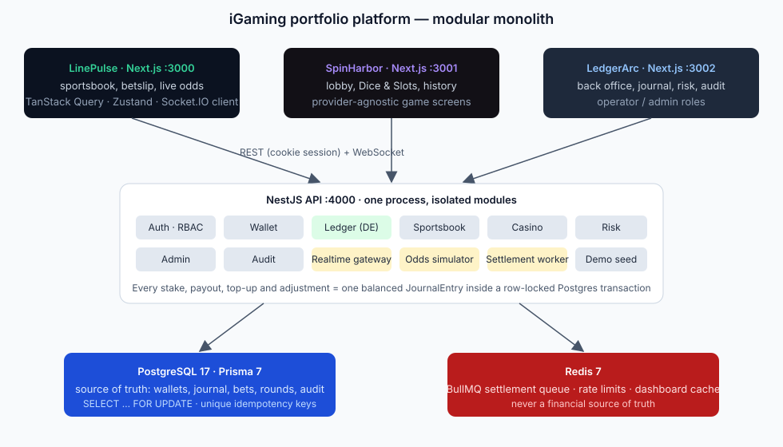
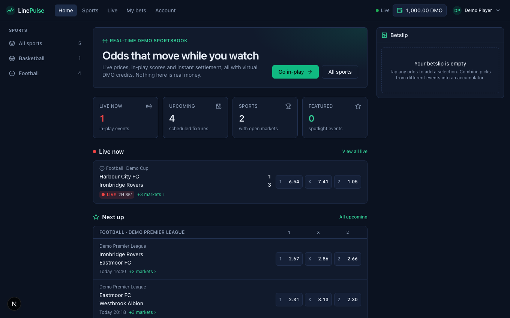
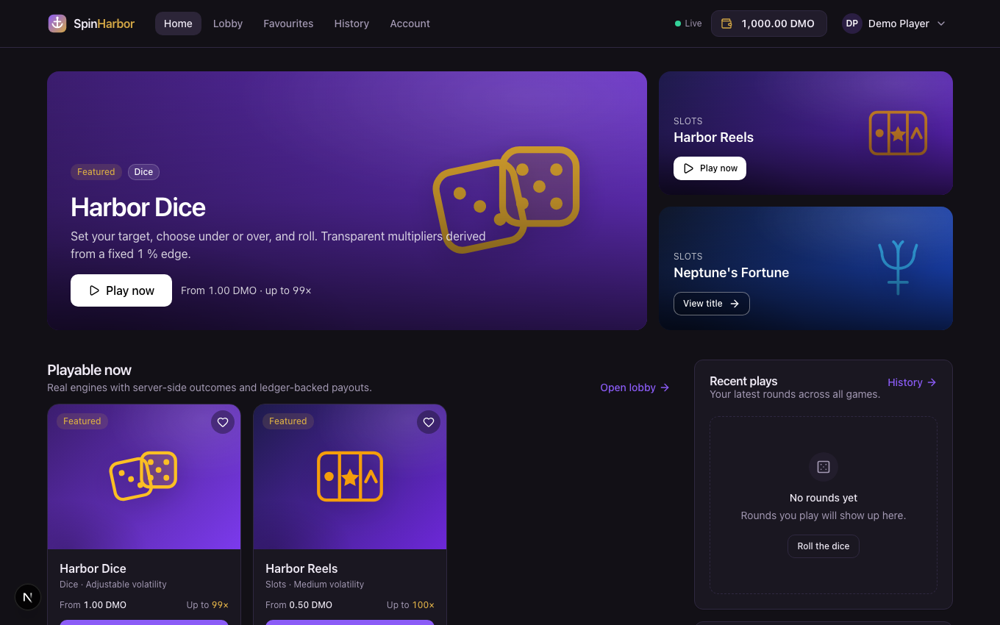
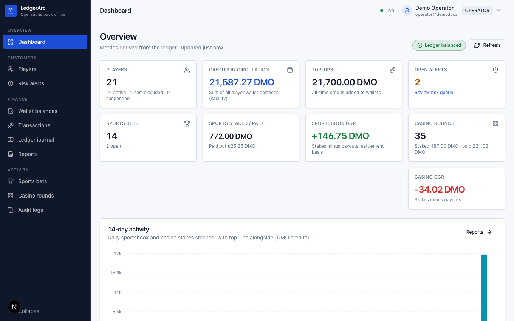
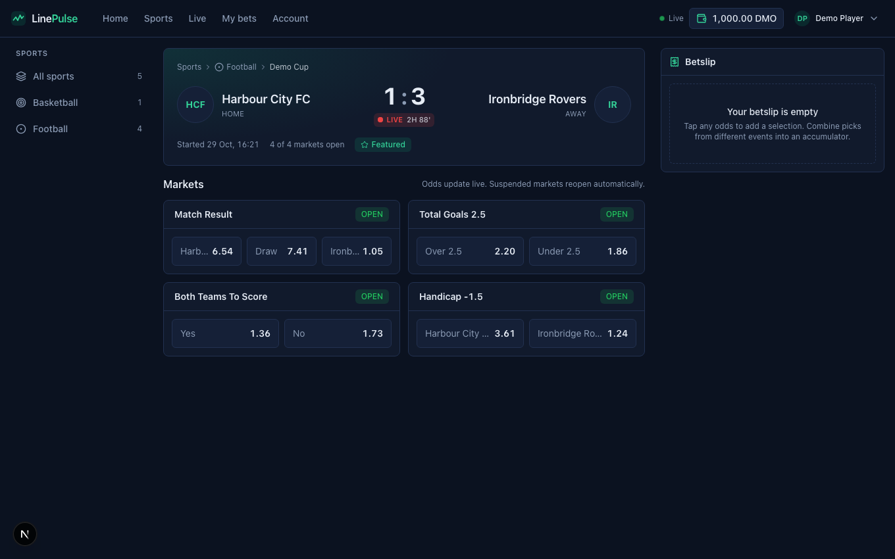
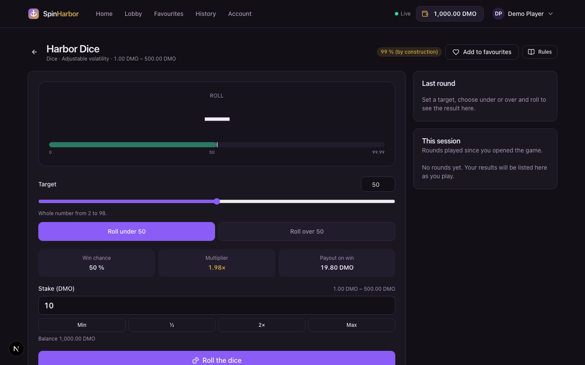
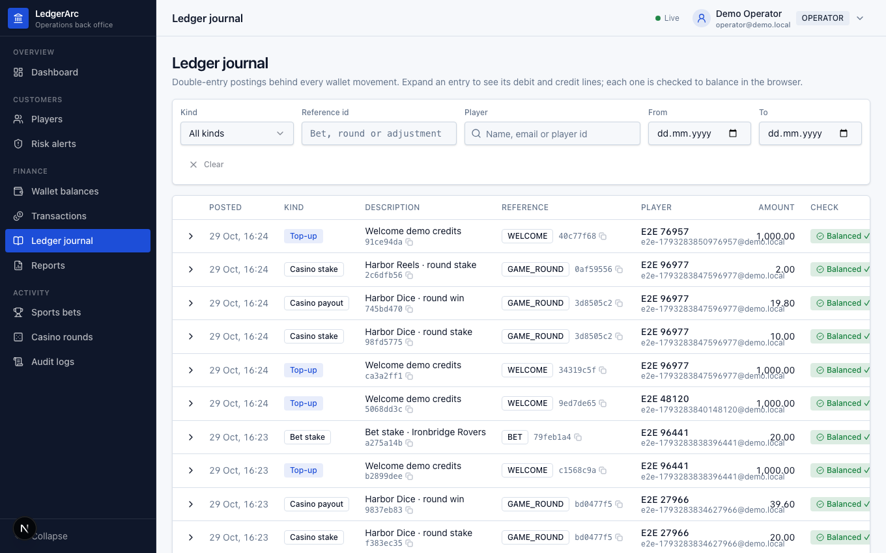
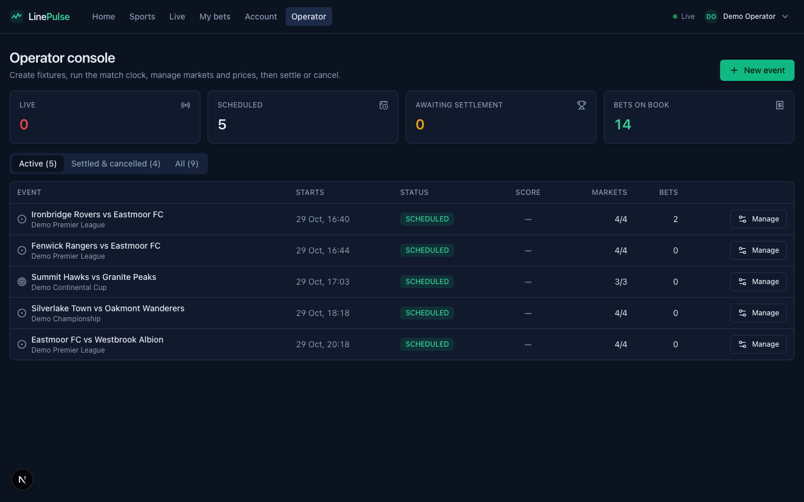
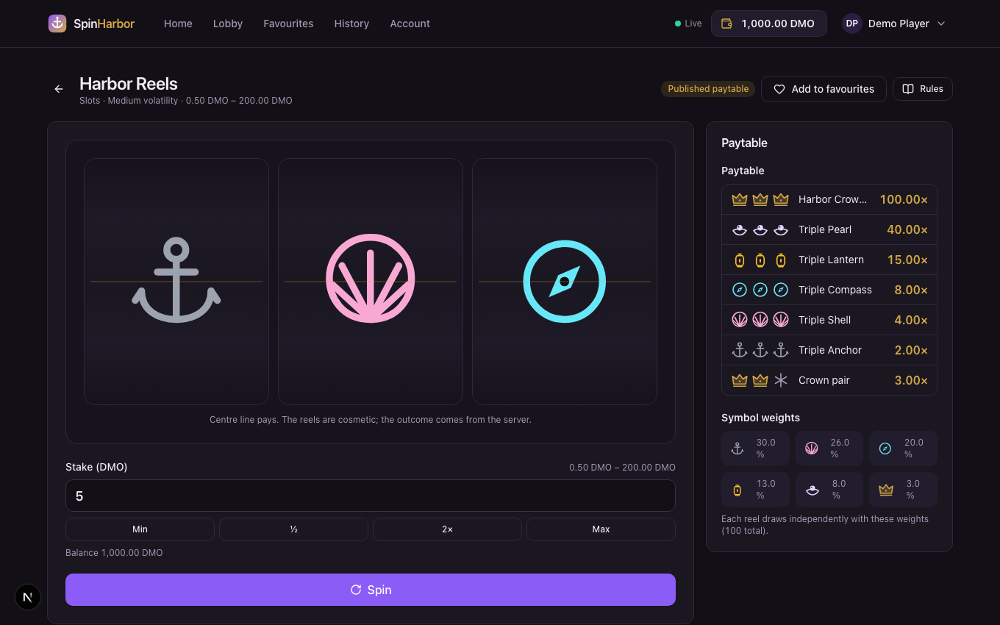
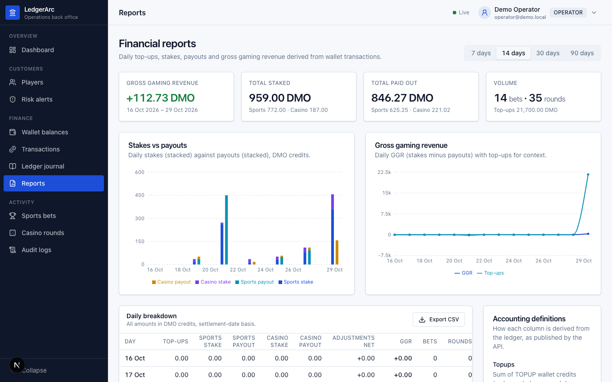

# iGaming Portfolio — LinePulse · SpinHarbor · LedgerArc

Repository: https://github.com/paliibo/igaming-portfolio · MIT licensed demo, no real money.

Three independently branded Next.js applications on one modular NestJS backend, sharing a single
player identity, a double-entry virtual-currency ledger and a real-time layer. Built as a portfolio
of iGaming engineering practice: transactional integrity, idempotency, concurrency safety,
server-authoritative game maths, responsible-gaming controls and operator tooling.

> Demo only. Virtual credits (`DMO`), simulated odds feed, in-process game provider. No real money,
> no payment gateway, no certified RNG, no licensing or compliance claims.

| App            | Port | What it is                                                                                                                                                            |
| -------------- | ---- | --------------------------------------------------------------------------------------------------------------------------------------------------------------------- |
| **LinePulse**  | 3000 | Real-time sportsbook: live odds over WebSockets, betslip with single and accumulator bets, stale-odds acceptance, My Bets, operator event management and settlement   |
| **SpinHarbor** | 3001 | Casino platform: catalogue, provider-adapter architecture, playable Harbor Dice and Harbor Reels with server-side outcomes, favourites, history, catalogue management |
| **LedgerArc**  | 3002 | Wallet, ledger and operations back office: dashboard, players, limits/self-exclusion/KYC, journal with reversals, reports, risk alerts, audit logs                    |
| **API**        | 4000 | NestJS modular monolith, Swagger at `/api/docs`, Socket.IO at `/ws`, BullMQ settlement worker                                                                         |



## Quick start

Requirements: Node ≥ 22, pnpm 11, Docker.

```bash
pnpm install
cp .env.example .env
docker compose up -d
pnpm db:generate
pnpm db:migrate
pnpm db:seed
pnpm dev
```

Then open LinePulse at http://localhost:3000, SpinHarbor at http://localhost:3001, LedgerArc at
http://localhost:3002 and the API docs at http://localhost:4000/api/docs. Demo accounts and a
walkthrough are in [docs/DEMO.md](docs/DEMO.md). If a port is taken, change `API_PORT`,
`NEXT_PUBLIC_API_URL` and `CORS_ORIGINS` in `.env` and start an app with
`pnpm --filter @igaming/linepulse exec next dev -p <port>`.

## Repository layout

```
apps/
  api/          NestJS backend (auth, users, wallet, ledger, sportsbook, casino, risk, admin, audit, realtime, demo seed)
  linepulse/    Next.js sportsbook
  spinharbor/   Next.js casino
  ledgerarc/    Next.js back office
packages/
  contracts/    zod request schemas, response DTO types, enums, money helpers, WebSocket event names
  database/     Prisma schema, migrations, generated client factory
  api-client/   fetch wrapper, TanStack Query hooks, Socket.IO provider
  ui/           shadcn-style primitives + design tokens shared by the three apps
  config/       shared tsconfig bases
e2e/            Playwright suite across the three apps
docs/           architecture, API, demo guide, per-app docs
infrastructure/ Postgres init (creates the test database)
```

## Engineering highlights

- **Double-entry ledger**: every stake, payout, top-up, adjustment and reversal is one balanced
  `JournalEntry` written atomically with the wallet update under `SELECT … FOR UPDATE`. Balances are
  `BigInt` minor units end to end; the API serialises them as strings. A reconciliation endpoint
  recomputes every entry and wallet from the journal.
- **Idempotency everywhere money moves**: bets `(userId, idempotencyKey)`, rounds
  `(userId, clientRoundKey)`, top-ups and adjustments via an `IdempotencyRecord` table; settlement
  claims a bet with a conditional `OPEN → final` update so repeated or concurrent jobs pay once.
- **Server-authoritative odds and outcomes**: bet placement re-reads prices inside the transaction
  and returns `409 PRICE_CHANGED` unless the client accepts; game outcomes come from an injectable
  random source behind a provider adapter interface (`createSession / playRound / closeSession`).
- **Responsible-gaming controls in the transaction path**: status (self-exclusion, cooling-off,
  suspension), daily wager/loss/top-up limits and alerts are enforced before any debit.
- **Real-time**: a simulated odds feed drifts prices, advances match clocks, suspends markets on
  goals and hands finished events to a BullMQ settlement worker; clients get `odds:update`,
  `event:update`, `wallet:update`, `bet:settled`.
- **Security**: bcrypt, JWT in an HttpOnly SameSite cookie, role guards, Origin allow-list, Redis
  rate limiting on sensitive routes, zod validation that also drives Swagger, production boot checks.
- **Tests**: 44 Vitest unit/integration tests against a real Postgres (concurrency, journal
  balance, duplicate settlement, idempotent rounds, limits, RBAC) plus 10 Playwright flows across
  the three apps (sign-in, browsing, bet placement with balance check, dice and slots rounds,
  operator views of the same transactions, role denial, phone-width overflow checks).

## Screenshots

| LinePulse                                                        | SpinHarbor                                               | LedgerArc                                                        |
| ---------------------------------------------------------------- | -------------------------------------------------------- | ---------------------------------------------------------------- |
|  |  |  |
|          |      |         |
|      |    |                |

Captured from the running apps with `node e2e/capture.mjs` (which also fails if any signed-in
page logs a console error).

## Scripts

| Command                                                                       | What it does                                                                                          |
| ----------------------------------------------------------------------------- | ----------------------------------------------------------------------------------------------------- |
| `pnpm dev`                                                                    | all four services in watch mode (turbo)                                                               |
| `pnpm build` / `pnpm typecheck` / `pnpm lint`                                 | every workspace                                                                                       |
| `pnpm test`                                                                   | API unit + integration tests (needs Postgres and Redis from compose)                                  |
| `pnpm test:e2e`                                                               | Playwright; add `E2E_START_SERVERS=1` to let it start the three apps (`E2E_*_PORT` to override ports) |
| `node e2e/capture.mjs`                                                        | Console-error sweep of 18 signed-in screens + screenshots into `docs/screenshots`                     |
| `pnpm db:generate` / `db:migrate` / `db:migrate:dev` / `db:seed` / `db:reset` | Prisma and seed                                                                                       |
| `pnpm verify`                                                                 | typecheck + lint + build + test                                                                       |

## Documentation

- [docs/DEMO.md](docs/DEMO.md) — accounts and walkthrough
- [docs/API.md](docs/API.md) — endpoints, WebSocket events, accounting model
- [docs/linepulse.md](docs/linepulse.md), [docs/spinharbor.md](docs/spinharbor.md), [docs/ledgerarc.md](docs/ledgerarc.md)
- [docs/FRONTEND_GUIDE.md](docs/FRONTEND_GUIDE.md) — shared UI conventions
- [PORTFOLIO.md](PORTFOLIO.md), [CV_PROJECT_DESCRIPTIONS.md](CV_PROJECT_DESCRIPTIONS.md)

## Known limitations

- Odds, fixtures and results are simulated locally; there is no commercial feed integration.
- The RNG is Node's CSPRNG behind a `RandomSource` interface; it is not a certified gaming RNG and no
  RTP has been formally tested (the dice multiplier and slots paytable are published instead).
- KYC is a status machine (pending / verified / rejected) edited by operators; there is no document
  verification or AML screening.
- One process runs API, simulator and settlement worker; splitting the worker out is a config
  change, not a redesign.
- Demo top-ups are the only "payment" method.
